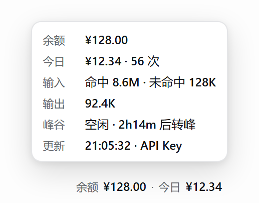

# 侧边栏钱包 · dsh-sidebar-wallet

在 DeepSeek Harness 侧边栏底部、账户行（头像那一行）的最右端显示一行读数：**余额** 与 **今日消费**；悬停展开明细卡片，点击立即刷新。

```
余额 ¥128.00 · 今日 ¥12.34
```



*界面示意（示例数据，按组件样式渲染）*

## 功能

- **余额**：官方 `GET /user/balance`——优先用已保存的 `DEEPSEEK_API_KEY`，取不到时退回当前登录的 DeepSeek 账号钱包。
- **今日消费**：DeepSeek 后台官方用量口径（北京时间 0 点起算，与网页控制台「用量」页一致）；官方不可用时回退本机会话日志估算，读数带 `≈`。
- **悬停 / 点击**：悬停显示余额、今日消费与请求数、输入（命中 / 未命中）、输出、峰谷倒计时、更新时间与来源；点击立即刷新。

## 安装

要求 DeepSeek Harness ≥ 0.2.1-rc.1（实测 0.2.1-rc.5）：

```bash
dsh plugin --profile desktop add github:chipcats/dsh-sidebar-wallet#v0.2.2
```

把 `desktop` 换成你的 profile 名，装好后刷新页面即可。

## 说明

- 官方用量来自 platform.deepseek.com 的网页私有接口 `api/v0/usage/export`（非公开 API）：插件通过 DSH 已登录账号的 `deepseekAccount.getPlatformSession()` 取用，无需手动粘贴 token；接口不可用时自动回退本地估算，不会让读数消失。
- 隐私与安全：只访问 `api.deepseek.com`（余额）和 `platform.deepseek.com`（用量）两个域名；令牌只在 Host 进程内存中使用，不下发浏览器、不落盘；只注册一个只读路由 `GET /dsh-sidebar-wallet/state.json`（回环 / 同源校验）。无写入、无遥测、无第三方运行时依赖。
- 已知限制：官方口径是该账户下全部 API 调用（不区分 Key 或客户端）；未登录 DeepSeek 账号时只显示本地估算；峰谷与节假日表仅用于本地估算和倒计时。

## 许可证

[MIT](./LICENSE)
