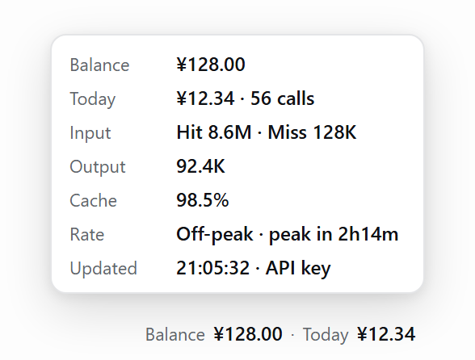

# Sidebar Wallet · dsh-sidebar-wallet

**English** | [简体中文](README.zh-CN.md)

A one-line readout at the far right end of the DeepSeek Harness sidebar account row: **balance** and **today's spend**. Hover for the details card, click to refresh.

```
Balance ¥128.00 · Today ¥12.34
```



*Sample data rendered from the component styles — not a screenshot.*

## Features

- **Balance**: the official `GET /user/balance` — uses the saved `DEEPSEEK_API_KEY` first, falling back to the signed-in DeepSeek account wallet.
- **Today's spend**: the official Platform usage export (Beijing calendar day, same numbers as the console's Usage page); falls back to a local session-log estimate, marked with `≈`.
- **Hover / click**: hover shows balance, today's spend and request count, input (hit / miss) tokens, output tokens, cache hit rate, the peak/off-peak countdown, update time and source; click refreshes.
- **Language**: the readout follows the DSH interface language (Chinese / English) and switches live with the Language setting.

## Install

Requires DeepSeek Harness ≥ 0.2.1-rc.1 (tested on 0.2.1-rc.5):

```bash
dsh plugin --profile desktop add github:chipcats/dsh-sidebar-wallet
```

## Notes

- The official usage comes from the private Platform web endpoint `api/v0/usage/export` (not a public API): the plugin reads the signed-in account session through DSH's `deepseekAccount.getPlatformSession()`, so no manual token is needed; when it is unavailable the local estimate is used instead and the readout never goes blank.
- Privacy & security: only two hosts are contacted — `api.deepseek.com` (balance) and `platform.deepseek.com` (usage); tokens stay in the Host process memory and are never sent to the browser or written to disk; the only route is a read-only `GET /dsh-sidebar-wallet/state.json` (loopback / same-origin fence). No writes, no telemetry, no third-party runtime dependencies.
- Known limits: the official figure covers every API call of the account (any API key or client); without a signed-in account only the local estimate is shown; the peak/off-peak and holiday tables only affect the local estimate and the countdown.

## License

[MIT](./LICENSE)
